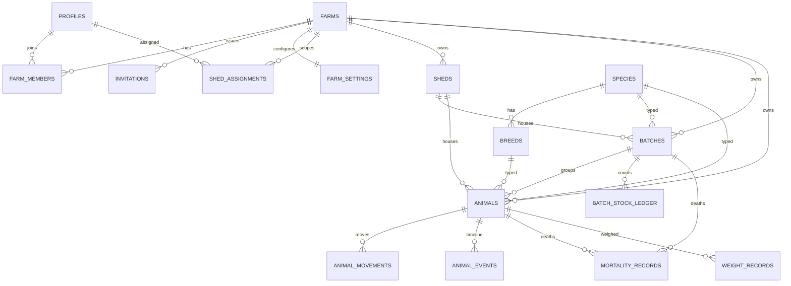
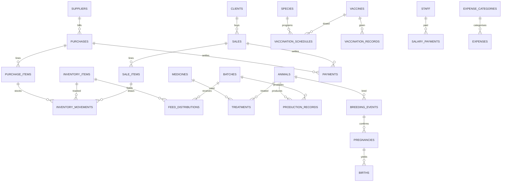

# HerdBook schema outline

Planning document for the data model. Tables are implemented as SQL migrations
phase by phase (see `docs/PROMPT.md` → Phased delivery plan); this file is the
agreed target and is kept in step with migrations as they land.

> Status: **Phase 1 tenancy implemented** in migration
> `20261029152058_tenancy.sql` (profiles, farms, farm_members, invitations,
> farm_settings + helpers, audit, RLS, RPCs). `shed_assignments` is deferred
> to Phase 2 (its `shed_id` FK needs the `sheds` table). Later phases fill in
> the rest; the tables below remain the agreed target.

## Conventions

Every business table has, unless noted:

| Column       | Type                      | Notes                               |
| ------------ | ------------------------- | ----------------------------------- |
| `id`         | `uuid` pk                 | `default gen_random_uuid()`         |
| `farm_id`    | `uuid` fk → `farms.id`    | tenant key; on every business table |
| `created_at` | `timestamptz`             | `default now()` (UTC)               |
| `created_by` | `uuid` fk → `profiles.id` |                                     |
| `updated_at` | `timestamptz`             | maintained by trigger               |
| `updated_by` | `uuid` fk → `profiles.id` |                                     |
| `deleted_at` | `timestamptz` null        | soft delete; `null` = active        |

Rules applied throughout (see `docs/PROMPT.md` → Database rules):

- Money `numeric(14,2)`; quantities `numeric(14,3)` + explicit unit.
- All timestamps `timestamptz` (UTC); displayed in the farm timezone.
- Foreign keys everywhere, `on delete restrict`. Index every FK and every
  `(farm_id, date)` used by reports.
- Farm-scoped uniqueness, e.g. `unique (farm_id, tag_number) where deleted_at is null`.
- Check constraints: quantities > 0, prices ≥ 0, discount ≤ subtotal.
- Lookup tables (not enums) for anything a farm may customise.
- RLS enabled on **every** table; no delete policy (soft delete only); finance
  tables readable only by Owner / Manager / Accountant.

## Table groups

### Tenancy & access (Phase 1)

| Table              | Key columns                                                                                                                           |
| ------------------ | ------------------------------------------------------------------------------------------------------------------------------------- |
| `farms`            | name, slug (unique), location, currency, timezone, created_by                                                                         |
| `profiles`         | id = auth.users.id, full_name, phone, avatar_url                                                                                      |
| `farm_members`     | farm_id, user_id → profiles, role (owner/manager/vet/worker/accountant), status (active/invited/suspended); unique (farm_id, user_id) |
| `invitations`      | farm_id, email, role, token, status, expires_at (7 days)                                                                              |
| `farm_settings`    | farm_id (unique), date_format, units, low_stock_threshold, overdue_days, invoice_prefix, logo_path                                    |
| `shed_assignments` | farm_id, user_id, shed_id (worker scoping)                                                                                            |

Helper SQL (`security definer`, `stable`, fixed `search_path`):
`is_farm_member(farm_id)`, `has_farm_role(farm_id, roles[])`.

### Reference / lookups (Phase 2) — farm-editable, seeded

`species`, `breeds (species_id)`, `units`, `expense_categories`,
`product_types`, `feed_types`.

### Housing & animals (Phase 2)

| Table                | Key columns                                                                                                                                                                                                |
| -------------------- | ---------------------------------------------------------------------------------------------------------------------------------------------------------------------------------------------------------- |
| `sheds`              | name, capacity, type                                                                                                                                                                                       |
| `batches`            | code (auto, prefixed), species_id, shed_id, start_date, status (active/closed)                                                                                                                             |
| `animals`            | tag_number (unique/farm), name, species_id, breed_id, sex, birth_date, dam_id, sire_id (self-fk), source (born/purchased), status (active/sold/dead/culled), current_batch_id, current_shed_id, photo_path |
| `animal_movements`   | animal_id, from_shed_id, to_shed_id, from_batch_id, to_batch_id, reason, moved_at                                                                                                                          |
| `animal_events`      | animal_id, type, ref_table, ref_id, occurred_at (timeline projection)                                                                                                                                      |
| `batch_stock_ledger` | append-only: batch_id, date, change (+/−), reason (purchase/birth/transfer/sale/death/cull), ref                                                                                                           |
| `mortality_records`  | batch_id?/animal_id?, date, count, cause, notes                                                                                                                                                            |
| `weight_records`     | animal_id?/batch_id? (sample), date, weight_kg                                                                                                                                                             |

### Purchasing, parties & inventory (Phase 3)

| Table                 | Key columns                                                                                                           |
| --------------------- | --------------------------------------------------------------------------------------------------------------------- |
| `suppliers`           | name, type, contact, photo_path, opening_balance                                                                      |
| `clients`             | name, type, contact, photo_path, opening_balance                                                                      |
| `staff`               | name, role, salary, start_date, user_id? (optional app account)                                                       |
| `purchases`           | invoice_no (gapless/farm), supplier_id, date, subtotal, order_discount, total, status                                 |
| `purchase_items`      | purchase_id, item_type (animal/feed/vaccine/medicine/other), ref_id, qty, unit, unit_price, line_discount, line_total |
| `inventory_items`     | type (feed/vaccine/medicine/product), name, unit, reorder_level                                                       |
| `inventory_movements` | append-only: item_id, type (purchase/use/distribution/sale/waste/adjustment), qty (+/−), ref, reason, date            |
| `invoice_counters`    | farm_id, doc_type, year, next_seq (row-locked, gapless)                                                               |

### Feed, health, breeding, production (Phase 4 / 6)

| Table                   | Key columns                                                                                                   |
| ----------------------- | ------------------------------------------------------------------------------------------------------------- |
| `feed_distributions`    | date, shed_id?/batch_id?, inventory_item_id, qty, inventory_movement_id                                       |
| `vaccines`              | name, species_id, inventory_item_id?                                                                          |
| `vaccination_schedules` | species_id, vaccine_id, dose_no, age_days?/interval_days?, route                                              |
| `vaccination_records`   | batch_id?/animal_id?, vaccine_id, date_given, given_by, withdrawal_end                                        |
| `medicines`             | name, inventory_item_id?                                                                                      |
| `treatments`            | animal_id?/batch_id?, medicine_id, diagnosis, dose, route, duration, vet_id, cost, withdrawal_end             |
| `health_events`         | subject, type, date, ref                                                                                      |
| `breeding_events`       | animal_id (dam), type (heat/service), method (AI/bull), sire_id?, date                                        |
| `pregnancies`           | dam_id, service_event_id, check_date, status, expected_birth                                                  |
| `births`                | pregnancy_id, date, offspring_animal_ids[]                                                                    |
| `production_records`    | date, product_type_id (milk/eggs/wool/manure), qty, unit, animal_id?/batch_id?, session (AM/PM), not_for_sale |

### Sales, money (Phase 5)

| Table             | Key columns                                                                                                                       |
| ----------------- | --------------------------------------------------------------------------------------------------------------------------------- |
| `sales`           | invoice_no (gapless/farm), client_id, date, subtotal, order_discount, total, status                                               |
| `sale_items`      | sale_id, item_type (animal/batch_count/product), ref_id, qty, unit, unit_price, line_discount, line_total                         |
| `payments`        | direction (in/out), party_type, party_id, invoice_type?, invoice_id?, amount, method (cash/mpesa/bank/cheque), reference_no, date |
| `expenses`        | category_id, amount, method, reference_no, date, shed_id?/batch_id?, receipt_path                                                 |
| `salary_payments` | staff_id, period, amount, method, date                                                                                            |

### System

`audit_log` (table, row_id, action, before/after jsonb, user, at — _no_
`farm_id`-only PK conventions apply but no soft delete), `attachments`,
`notifications`, plus the reporting **views**: `v_batch_current_stock`,
`v_inventory_on_hand`, `v_invoice_balances`, `v_batch_pnl`.

## ER diagram — tenancy & core (Phase 1–2)

## ER diagram — operations & finance (Phase 3–6)

